# DevOps Final Project

Python backend у Docker, інфраструктура AWS EKS через Terraform та автоматичне розгортання через GitHub Actions і Argo CD.

Після push коду в `main` пайплайн збирає образ, публікує його в Docker Hub і записує SHA-тег у Kubernetes-маніфест. Argo CD відстежує Git та оновлює Deployment. Для застосунку й Argo CD налаштовані TLS-сертифікати Let's Encrypt і перенаправлення HTTP → HTTPS.

## Посилання

| Ресурс | Адреса |
| --- | --- |
| Репозиторій | [Morphess/DevOps-Final-Project](https://github.com/Morphess/DevOps-Final-Project) |
| Застосунок | [app.morphess-devops.pp.ua](https://app.morphess-devops.pp.ua) |
| Argo CD | [argocd.morphess-devops.pp.ua](https://argocd.morphess-devops.pp.ua) |
| Docker Hub | [morphess/devops-backend](https://hub.docker.com/r/morphess/devops-backend) |

## Компоненти

| Компонент | Налаштування проєкту |
| --- | --- |
| Backend | Python, стандартна бібліотека, GET `/`, порт `8089` |
| Контейнер | `python:3.13-slim`, користувач `10001:10001` |
| AWS | Регіон `eu-central-1`, стандартна VPC |
| EKS | `morphess-devops`, Kubernetes `1.36` |
| Робочі ноди | Група `morphess-devops-nodes`, одна нода `m7i-flex.large` |
| Ingress | F5 NGINX Ingress Controller, клас `nginx` |
| Зовнішній доступ | AWS Network Load Balancer перед NGINX |
| GitOps | Argo CD, Application `devops-backend`, namespace `devops-app` |
| TLS | cert-manager, ClusterIssuer `letsencrypt-prod`, HTTP-01 |

### Як відбувається оновлення

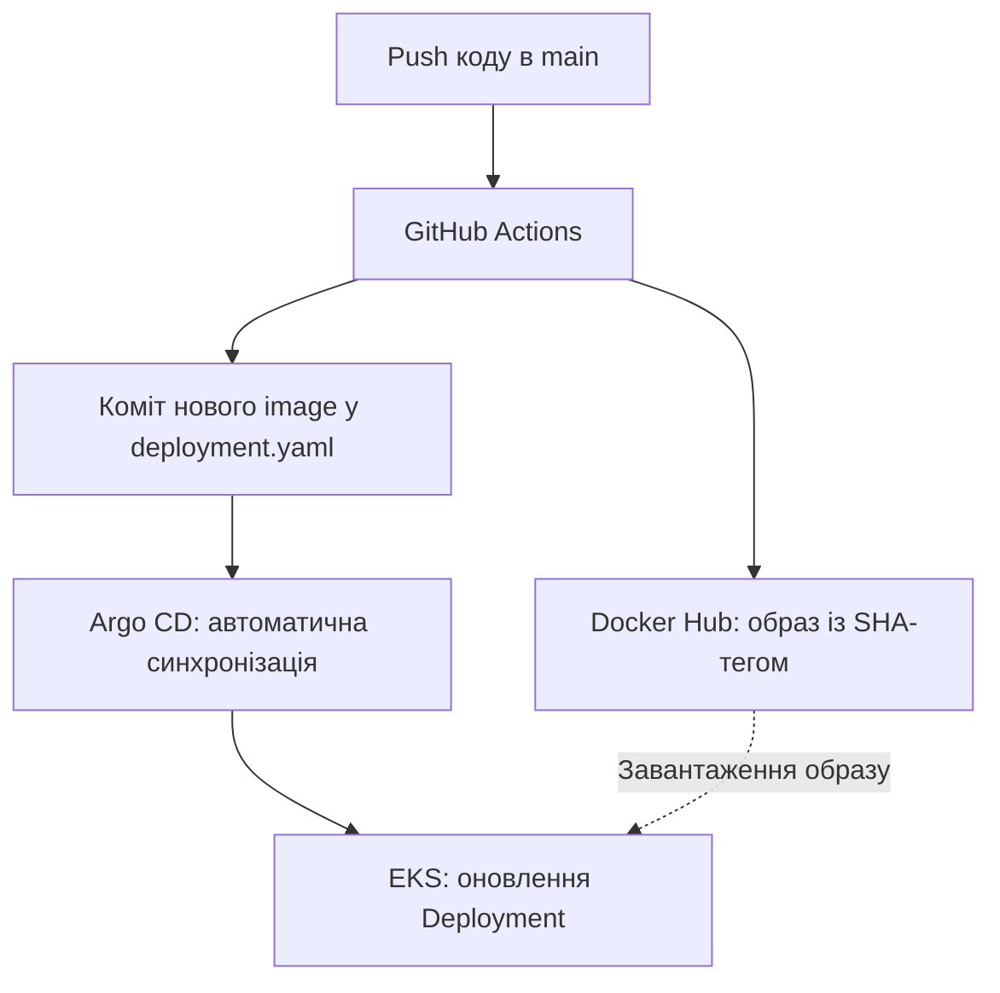

Зовнішній запит проходить через DNS, AWS NLB та NGINX. Правило Ingress спрямовує його до Service застосунку або Argo CD. TLS завершується на NGINX; з'єднання NGINX з `argocd-server` також використовує HTTPS.

## Основні файли

| Шлях | Призначення |
| --- | --- |
| `app.py` | HTTP-сервер із JSON-відповіддю |
| `Dockerfile`, `.dockerignore` | Збірка контейнера |
| `.github/workflows/docker-publish.yml` | Збірка, push образу, оновлення маніфесту в Git |
| `terraform/infra/` | EKS, IAM та використання наявної VPC |
| `terraform/addons/` | Helm-релізи NGINX, Argo CD та cert-manager |
| `k8s/platform/` | ClusterIssuer та Ingress для Argo CD |
| `k8s/app/` | Deployment, Service та Ingress backend |
| `k8s/argocd/application.yaml` | Application із автоматичною синхронізацією |
| `screenshots/` | Підтвердження етапів виконання |

## 1. Python backend

Сервер слухає порт `8089`. GET `/` повертає HTTP 200 та JSON із повідомленням, версією, ім'ям Pod і його IP. При локальному запуску поза Kubernetes поле `pod_ip` може бути `null`.

```bash
python3 app.py
```

В іншому терміналі:

```bash
curl -i http://127.0.0.1:8089/
```

Локальний запуск Python backend і відповідь HTTP 200 на GET /.

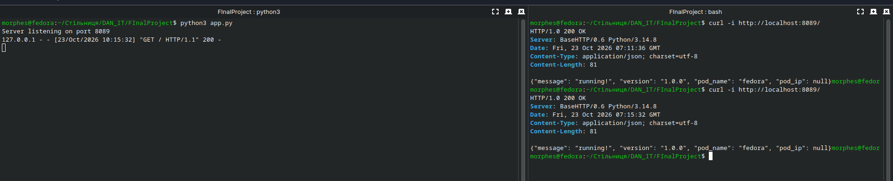

## 2. Docker-образ і локальна перевірка

Dockerfile використовує `python:3.13-slim`, копіює `app.py` у `/app` і запускає сервер від користувача без root-прав.

```bash
docker build -t devops-backend:local .
docker run --rm --name devops-backend-local \
  -p 127.0.0.1:8089:8089 devops-backend:local
```

В іншому терміналі перевіряється GET `/`. Перед наступним запуском на тому самому порту попередній сервер потрібно зупинити.

Збірка Docker-образу, запуск контейнера та перевірка HTTP 200.

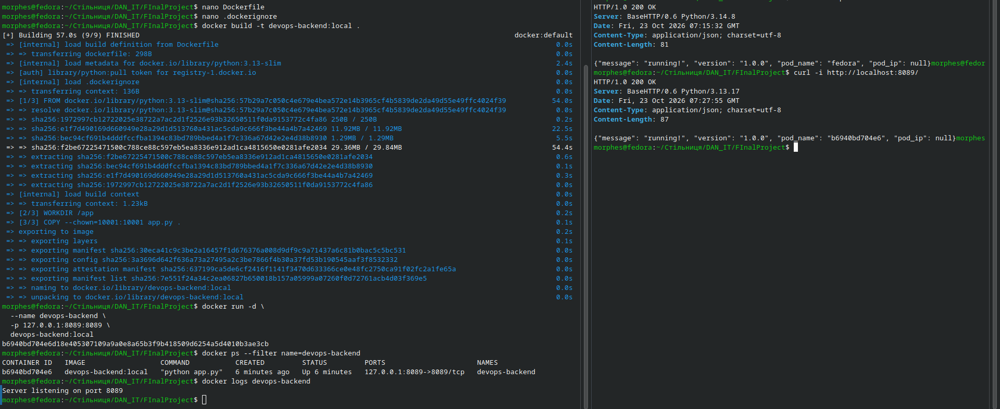

## 3. Docker Hub і початковий CI

Створено репозиторій `morphess/devops-backend`. Спочатку він був приватним, згодом став публічним для завантаження образів кластером.

У GitHub Secrets додано `DOCKERHUB_USERNAME` та `DOCKERHUB_TOKEN`. Workflow використовує їх для входу в Docker Hub. Образ публікується з тегами `latest` та повним SHA коміту.

Назви GitHub Secrets для Docker Hub; значення секретів не відображаються.

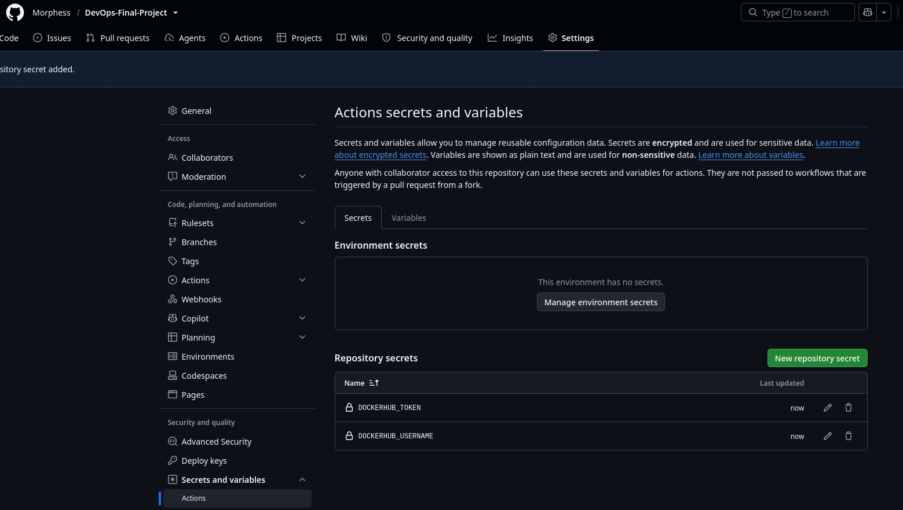

Перший успішний запуск workflow збірки й публікації образу.

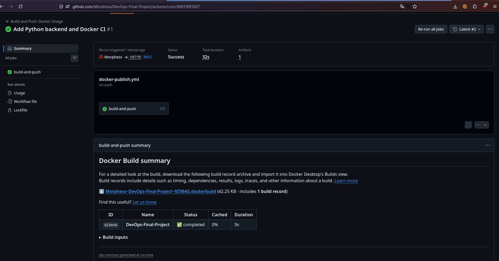

Публічний репозиторій Docker Hub із тегами latest і SHA коміту.

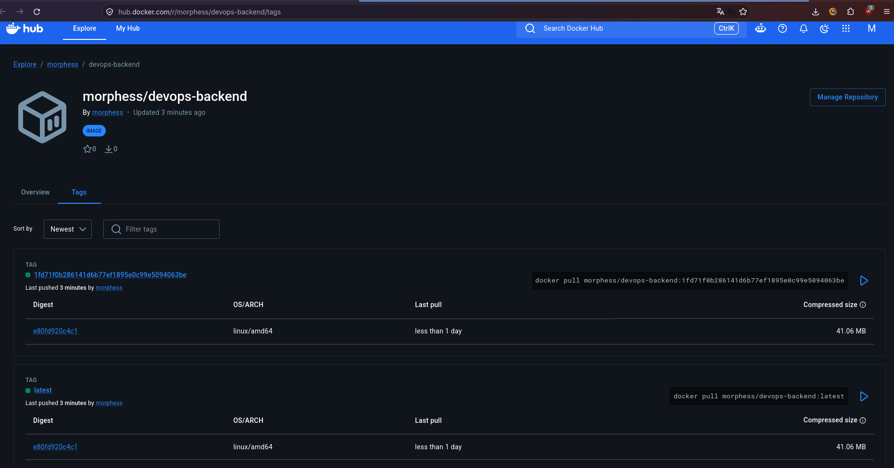

<details>
<summary>Створення репозиторію та перевірка опублікованого образу</summary>

Створення репозиторію morphess/devops-backend; на цьому початковому етапі він ще приватний.

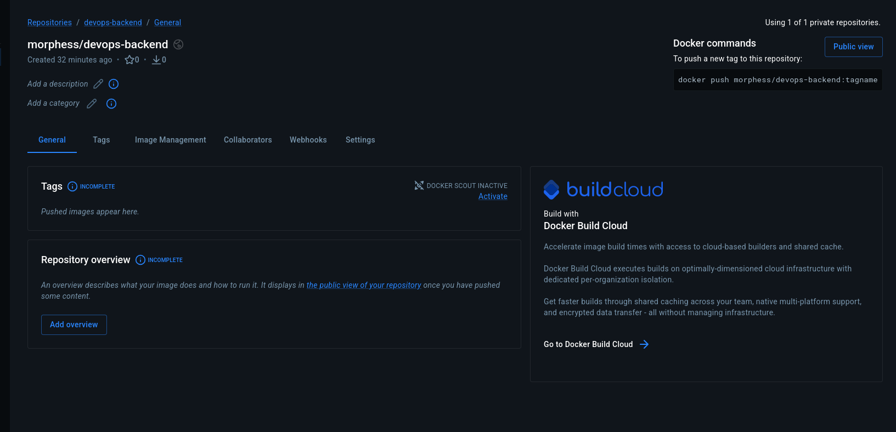

Завантаження образу з Docker Hub, запуск контейнера та перевірка відповіді.

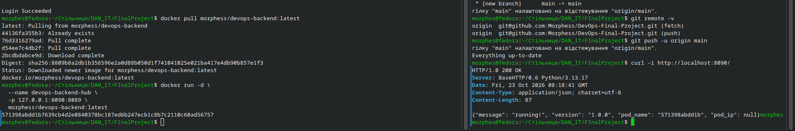

</details>

## 4. Підготовка AWS

Перевірено стандартну VPC та підмережі регіону `eu-central-1`. Для роботи створено IAM-користувача `devops-final` із MFA. На скриншоті зафіксовані широкі права навчального користувача; це опис фактичної конфігурації, а не приклад мінімально необхідних дозволів.

AWS CLI використовує профіль `devops-final` для входу та `devops-terraform` як профіль для Terraform і kubeconfig. Дані сеансу не зберігаються в Git.

Перевірка стандартної VPC та підмереж у трьох зонах доступності.

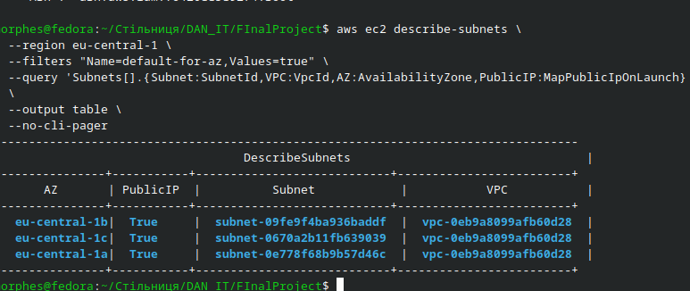

IAM-користувач devops-final, призначені політики та підтвердження налаштування MFA.

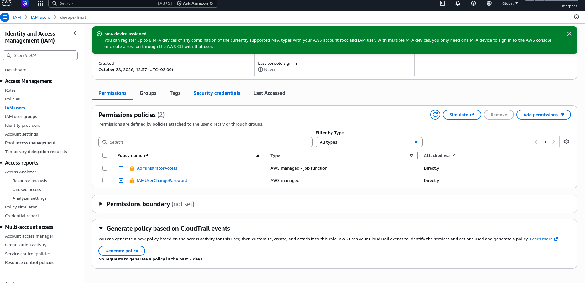

## 5. EKS через Terraform

У `terraform/infra/` описано IAM-ролі, EKS і managed node group. Підсумкова конфігурація має одну ноду `m7i-flex.large`; `minSize`, `maxSize` та `desiredSize` дорівнюють `1`.

План перевірявся до застосування. Кількість ресурсів на ранньому скриншоті відрізняється від фінального плану, оскільки конфігурація доповнювалася.

Збережений план eks.tfplan: 8 ресурсів до додавання, Kubernetes 1.36.

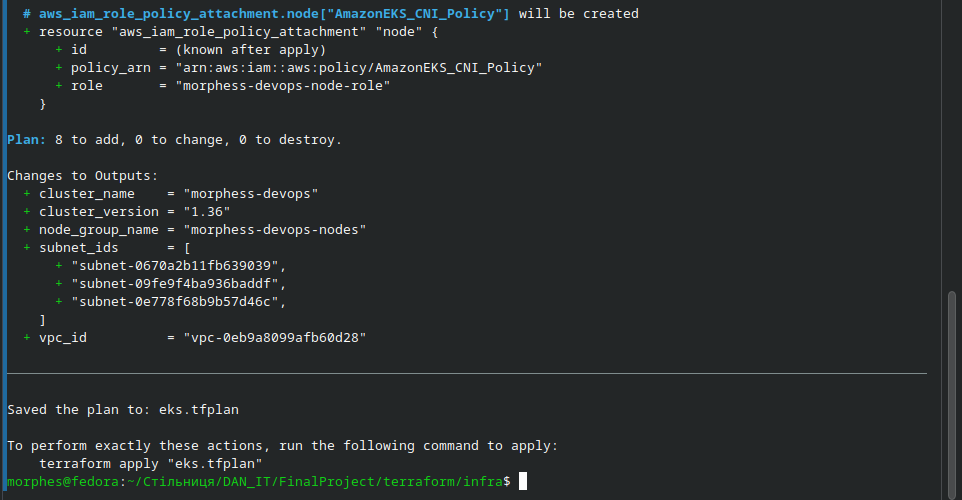

Успішний apply та node group ACTIVE: одна нода m7i-flex.large.

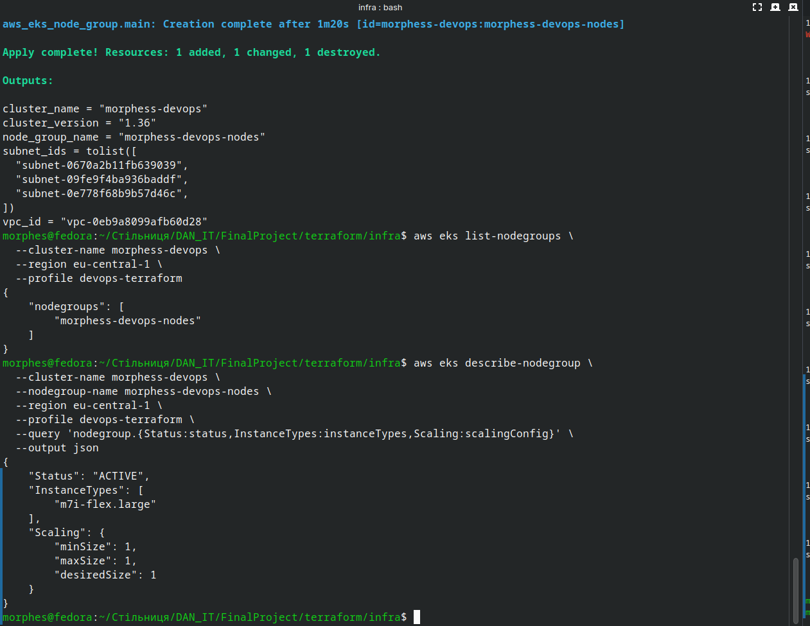

Контекст morphess-devops і робоча нода у стані Ready.

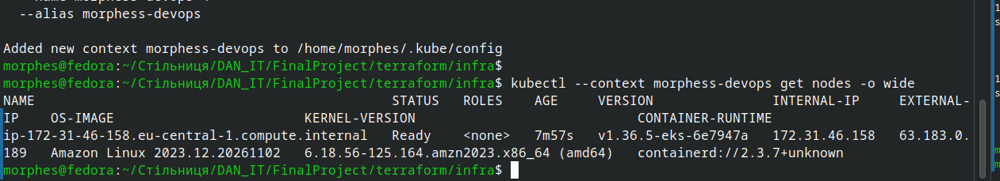

Системні компоненти aws-node, CoreDNS і kube-proxy працюють.

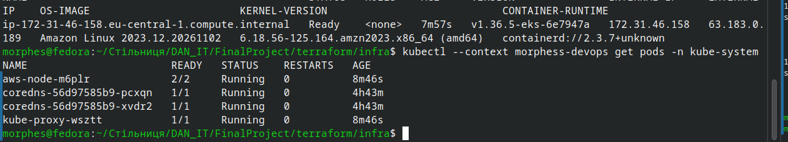

<details>
<summary>Ранній план інфраструктури</summary>

Проміжний план Terraform: 6 ресурсів до додавання; ще не фінальний план EKS.

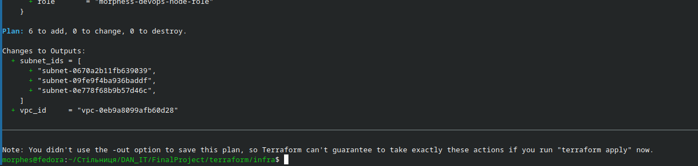

</details>

## 6. NGINX Ingress Controller

У `terraform/addons/nginx.tf` налаштовано Helm-реліз F5 NGINX Ingress Controller. Service типу `LoadBalancer` надає зовнішню адресу AWS NLB. Для правил Ingress використовується клас `nginx` та анотації `nginx.org/*`.

Встановлення NGINX Ingress Controller через Terraform і Helm.

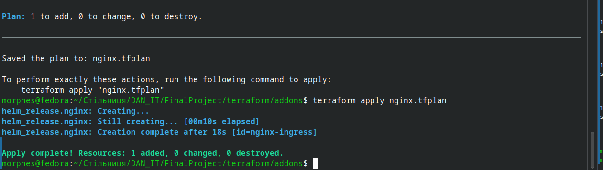

NGINX Pod Running, Service LoadBalancer та IngressClass nginx.

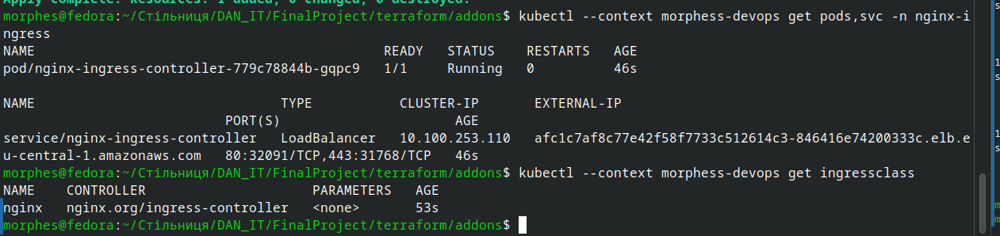

## 7. Власний домен і DNS

Для домену `morphess-devops.pp.ua` у NIC.UA створено два CNAME:

| Ім'я | Призначення |
| --- | --- |
| `app` | Доменне ім'я AWS Load Balancer |
| `argocd` | Те саме доменне ім'я AWS Load Balancer |

У цьому DNS-редакторі ціль CNAME введена як повне ім'я з крапкою наприкінці. Без неї раніше дописувався суфікс власного домену. Правильні записи перевірено запитом до авторитетного DNS `ns10.uadns.com`.

DNS-записи app та argocd у NIC.UA спрямовані на AWS Load Balancer.

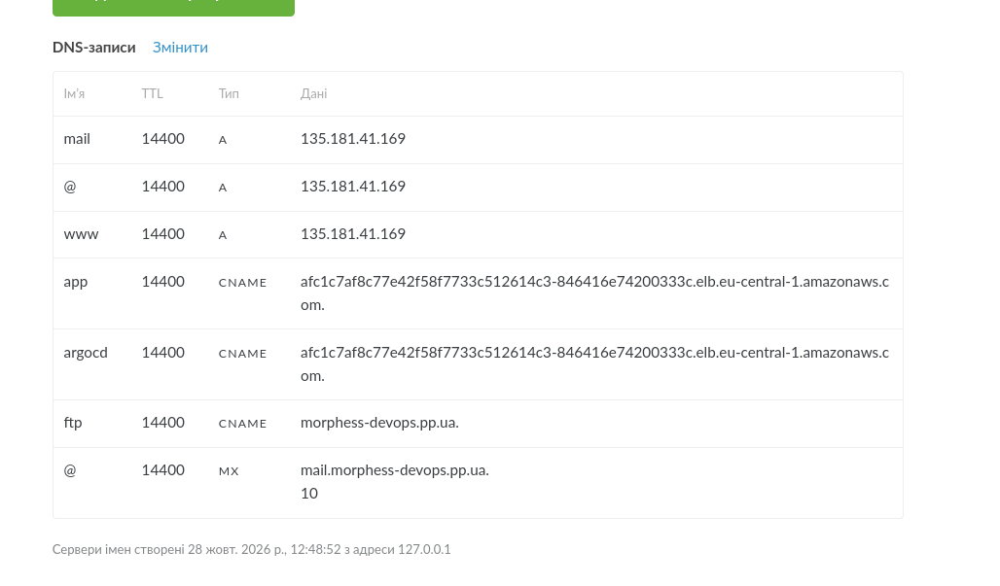

Авторитетний DNS ns10.uadns.com повертає правильні CNAME для app та argocd.

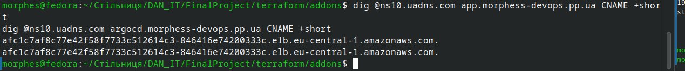

<details>
<summary>Перша перевірка доступності NGINX до створення Ingress застосунку</summary>

Проміжна перевірка: NGINX доступний, але до створення маршруту застосунку відповідає 404.

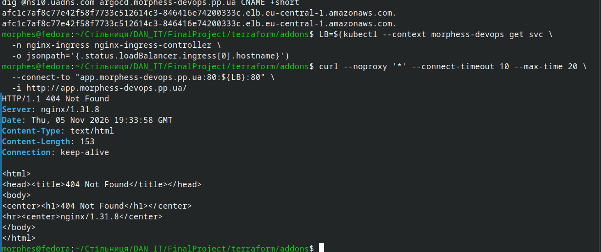

</details>

## 8. Встановлення Argo CD

Argo CD встановлено Helm-релізом через Terraform у namespace `argocd`. Перевірено стан компонентів та внутрішні Service. Job `argocd-redis-secret-init` у стані `Completed` успішно завершив свою роботу.

Успішне встановлення Argo CD через Terraform і Helm.

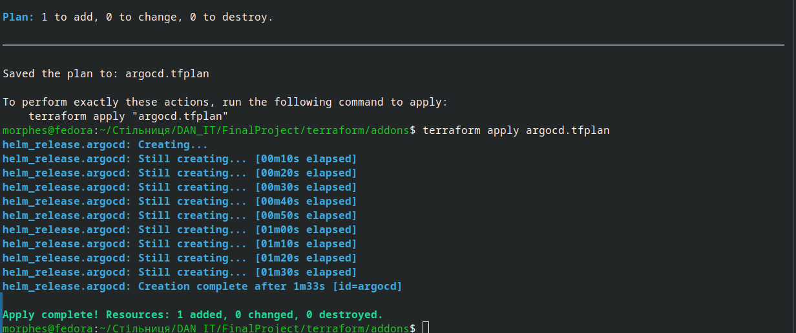

Перевірка Pod і Service Argo CD; redis-secret-init завершився зі статусом Completed.

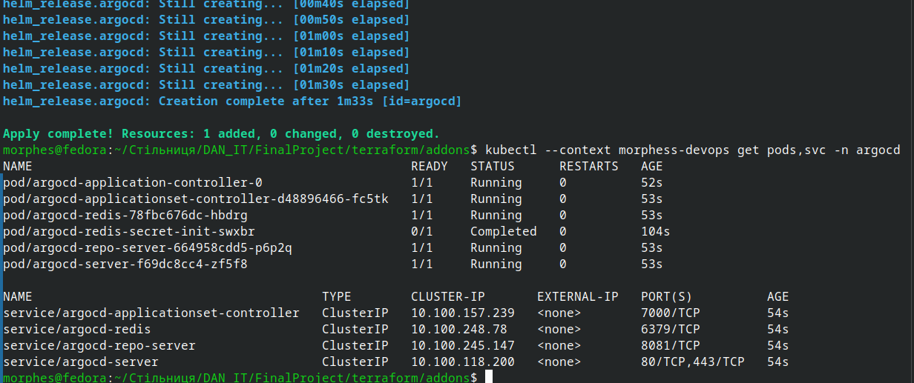

## 9. cert-manager і Let's Encrypt

cert-manager встановлено через Terraform і Helm. ClusterIssuer `letsencrypt-prod` використовує production ACME-сервер Let's Encrypt, реальну контактну електронну адресу та HTTP-01 через IngressClass `nginx`.

Стан `Ready=True` у ClusterIssuer підтверджує готовність видавця; окремо перевіряються сертифікати обох сервісів.

Встановлення cert-manager і три його компоненти у стані Running.

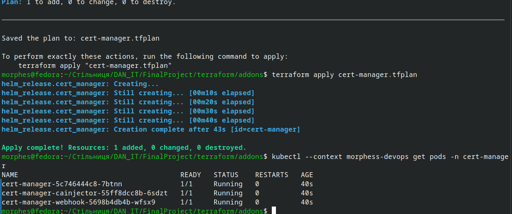

ClusterIssuer letsencrypt-prod готовий: Ready=True.

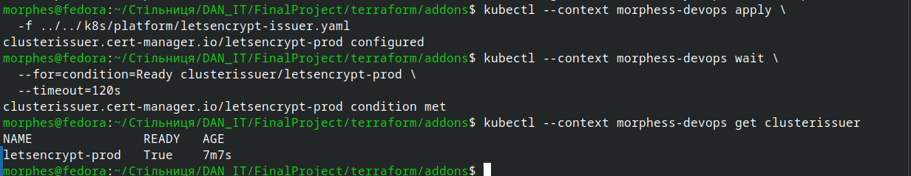

## 10. HTTPS для Argo CD

Ingress `argocd` використовує домен `argocd.morphess-devops.pp.ua` та Secret `argocd-ingress-tls`. Анотація `nginx.org/ssl-services` задає HTTPS-з'єднання з `argocd-server`; `nginx.org/ssl-redirect` вмикає редирект на HTTPS.

Після видачі сертифіката відкрито сторінку входу. Порожній список Applications на наступному скриншоті — очікуваний стан до створення Application.

TLS-сертифікат Argo CD готовий; Ingress має домен та адресу балансувальника.

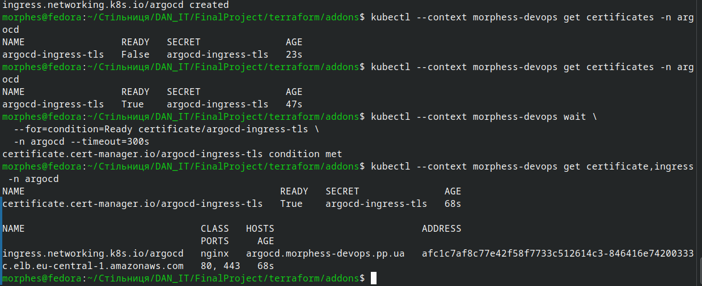

Сторінка входу Argo CD відкривається за власним доменом через HTTPS.

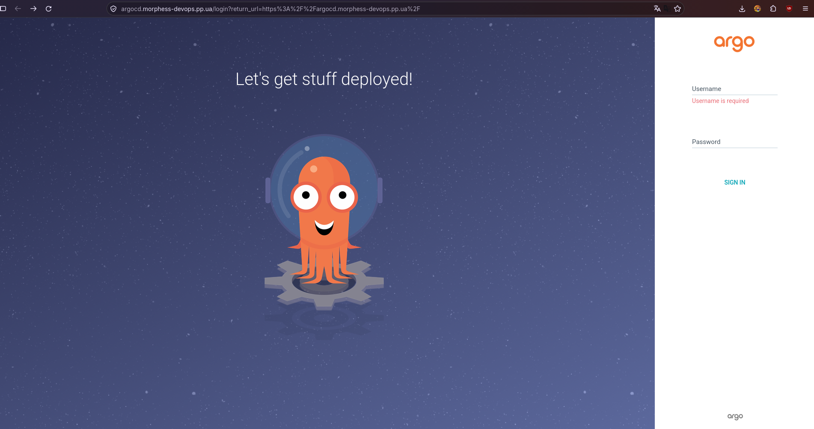

<details>
<summary>Перевірка HTTPS-відповіді та інтерфейс до створення Application</summary>

HTTPS-відповідь Argo CD: HTTP 200 із перевіркою TLS, через --connect-to для обходу старого DNS.

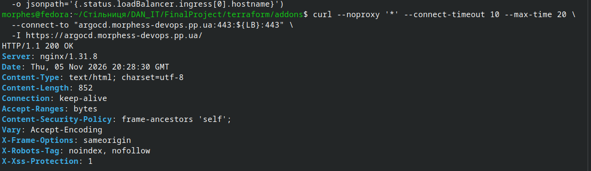

Інтерфейс Argo CD після входу, до створення Application.

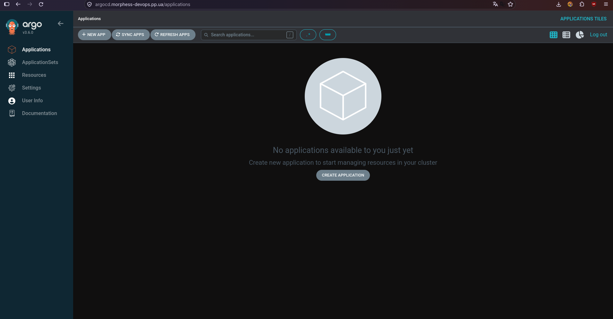

</details>

## 11. Маніфести застосунку та Argo CD Application

У `k8s/app/` додано Deployment, Service та Ingress. Deployment запускає один контейнер на порту `8089`, має readiness/liveness probes і requests/limits. Service спрямовує порт `80` на іменований порт контейнера `http`.

Application `devops-backend` відстежує гілку `main`, каталог `k8s/app` і розгортає ресурси в namespace `devops-app`. Увімкнено автоматичну синхронізацію, `prune`, `selfHeal` та створення namespace. Для HTTP-01 враховано тимчасові challenge-шляхи cert-manager, щоб синхронізація не видаляла їх під час видачі сертифіката.

На початковому розгортанні застосунок повертав версію `1.0.0`. Сертифікат `devops-backend-tls` перейшов у `Ready=True`; Argo CD показав `Healthy / Synced`.

Pod, Service, Ingress та сертифікат застосунку; фінальний стан Certificate Ready=True.

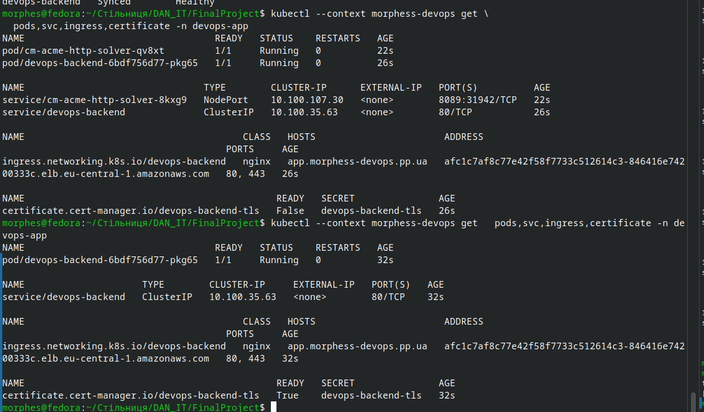

Початкова версія застосунку 1.0.0 доступна через HTTPS.

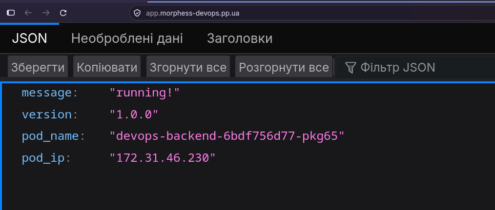

Application devops-backend: Healthy і Synced, гілка main, шлях k8s/app.

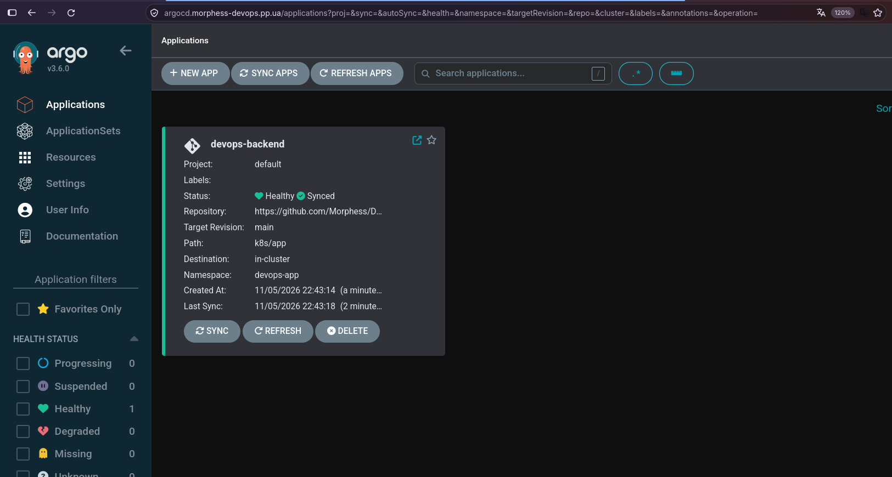

## 12. Автоматичне оновлення образу в Git

Після успішного push образу workflow змінює поле `image` у `k8s/app/deployment.yaml`, підставляючи `${GITHUB_SHA}`. Потім бот створює коміт і пушить його в `main`. Для запису в репозиторій workflow має `contents: write`.

Deployment використовує SHA-тег, тому нова збірка змінює Pod template та запускає rollout. `latest` залишається додатковим тегом у Docker Hub.

На першій перевірці бот уже змінив маніфест у Git, а кластер ще використовував `latest`. Після початкового ручного refresh образ у кластері оновився. 

Усі кроки workflow, включно з Update deployment image in Git, виконані успішно.

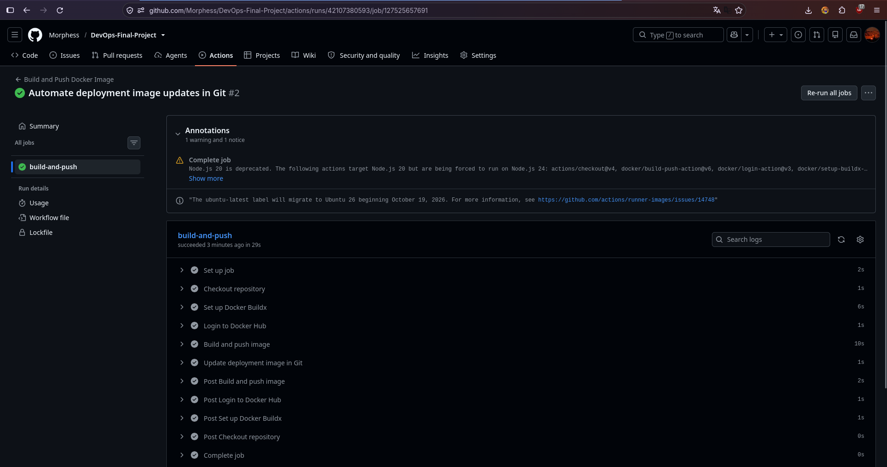

<details>
<summary>Перший запуск GitOps workflow і початкова синхронізація</summary>

Успішний workflow після додавання автоматичного оновлення маніфесту.

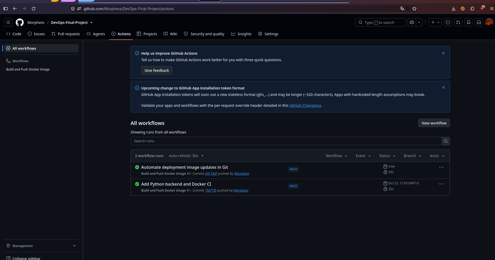

Проміжний стан: бот уже записав SHA-тег у Git, а Deployment ще використовує latest.

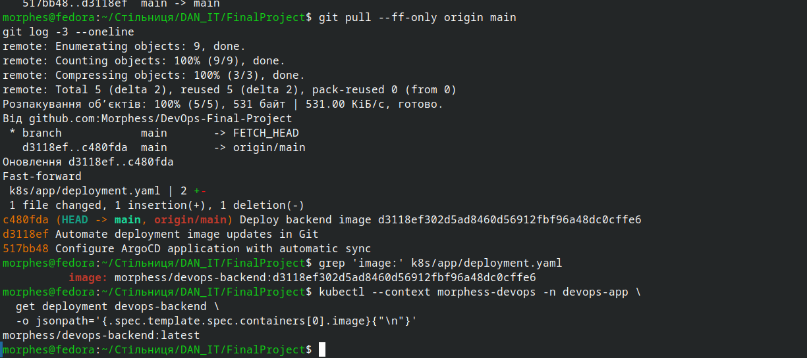

Перше оновлення Deployment до SHA-тега після ручного refresh; 

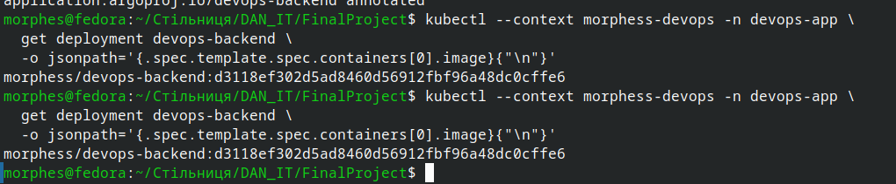

</details>

## 13. Перевірка повного циклу: 1.0.0 → 1.0.1

У `app.py` змінено лише версію відповіді з `1.0.0` на `1.0.1`, створено коміт `bc1eeca` та виконано push у `main`. Workflow успішно зібрав і опублікував новий образ та оновив маніфест у Git.

Для цього контрольного оновлення ручний Sync/Refresh не запускався. Після автоматичної синхронізації застосунок повернув `1.0.1`. Deployment використовує тег `bc1eecadda894bf0e8224c8719f7466e2c0b471e`, а Application має статус `Synced / Healthy`.

Зміна версії з 1.0.0 на 1.0.1, коміт bc1eeca та push у main.

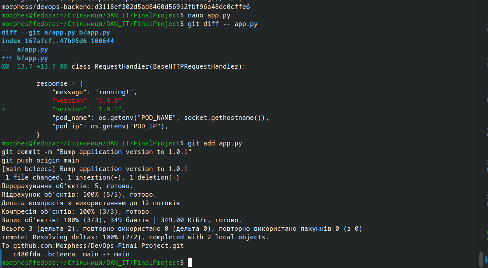

Workflow для коміту зі зміною версії на 1.0.1 успішно завершений.

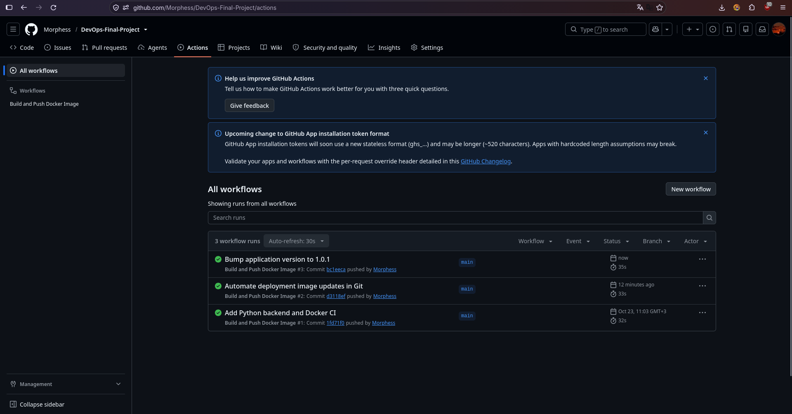

Після оновлення застосунок повертає 1.0.1; ім’я Pod відрізняється від початкового.

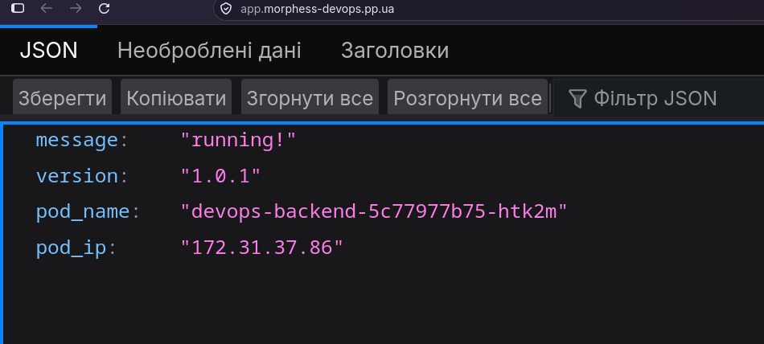

Deployment використовує SHA коміту bc1eeca…, Application має статус Synced і Healthy.

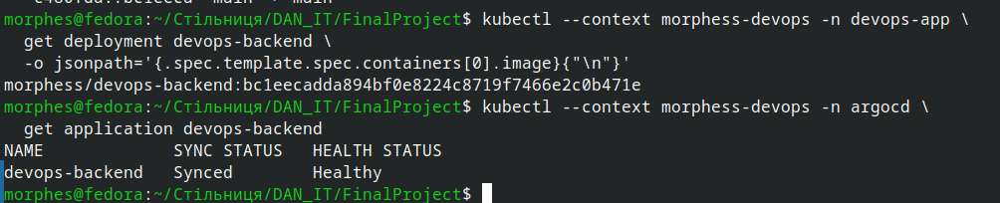

## 14. HTTP → HTTPS і перевірка DNS

Для обох доменів перевірено HTTP 301 із заголовком `Location: https://…:443/`. Спочатку використано `--connect-to`, щоб перевірити Ingress через адресу балансувальника під час кешування старого CNAME системним DNS.

Після тимчасової зміни DNS у Fedora на Cloudflare ті самі запити пройшли без `--connect-to`. Це відокремило проблему старого DNS-запису від роботи NGINX, TLS і застосунку. 

Обидва HTTP-запити повертають 301 на HTTPS; перевірка через --connect-to.

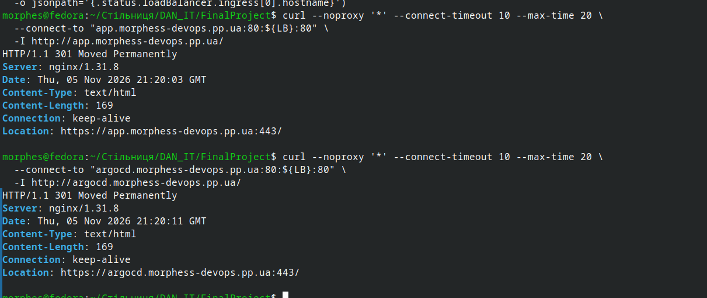

Після тимчасової зміни DNS обидва домени повертають 301 без --connect-to; наприкінці налаштування скасовано.

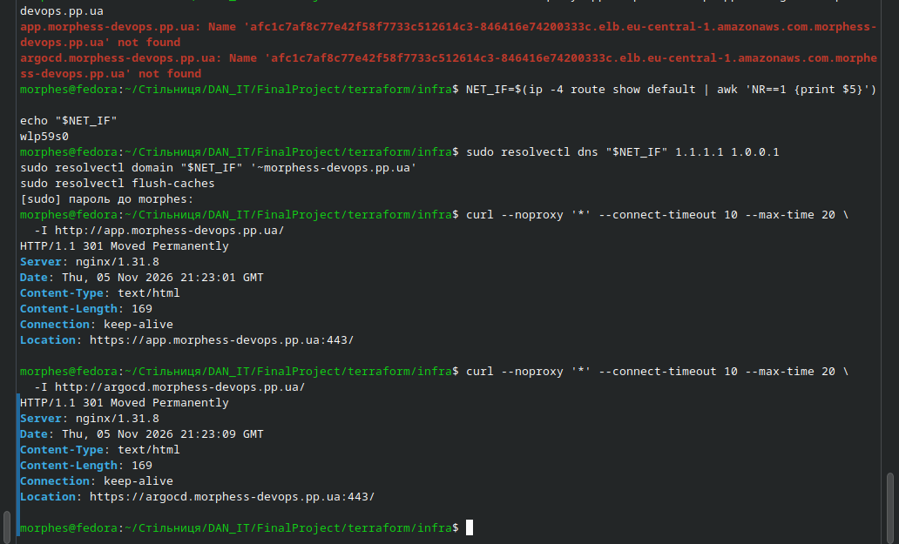

## Команди перевірки

Виконувати з AWS-сесією та kubeconfig для цього кластера:

```bash
kubectl --context morphess-devops get nodes
kubectl --context morphess-devops get pods -n kube-system
kubectl --context morphess-devops get pods,svc -n nginx-ingress
kubectl --context morphess-devops get pods -n argocd
kubectl --context morphess-devops get pods -n cert-manager
kubectl --context morphess-devops get clusterissuer
kubectl --context morphess-devops get certificate,ingress -n argocd
kubectl --context morphess-devops get pods,svc,ingress,certificate -n devops-app
kubectl --context morphess-devops get application devops-backend -n argocd
```

Перевірка версії образу та відповіді застосунку:

```bash
kubectl --context morphess-devops -n devops-app \
  get deployment devops-backend \
  -o jsonpath='{.spec.template.spec.containers[0].image}{"\n"}'

curl --noproxy '*' --connect-timeout 10 --max-time 20 \
  https://app.morphess-devops.pp.ua/

curl --noproxy '*' --connect-timeout 10 --max-time 20 \
  -I http://app.morphess-devops.pp.ua/

curl --noproxy '*' --connect-timeout 10 --max-time 20 \
  -I http://argocd.morphess-devops.pp.ua/
```

Для перевірки відповіді Python backend використовується GET. Параметр `-I` вище застосовано до HTTP-адрес для перевірки редиректу на Ingress.

## Порядок повторного розгортання

Потрібні AWS CLI, Terraform, kubectl, Git і Docker для локальної перевірки. Перед повторним розгортанням слід налаштувати власні AWS-профілі, доступні підмережі/VPC, дозволений CIDR для EKS API, домени, контактний email та адреси Git/Docker Hub. 

1. Налаштувати AWS CLI та чинну сесію. Використано профілі `devops-final` і `devops-terraform`.
2. У `terraform/infra/` виконати `terraform init`, `terraform validate`, переглянути `terraform plan` і застосувати погоджений план.
3. Додати контекст кластера до kubeconfig:

   ```bash
   aws eks update-kubeconfig \
     --profile devops-terraform \
     --region eu-central-1 \
     --name morphess-devops \
     --alias morphess-devops
   ```

4. У `terraform/addons/` виконати `terraform init`, переглянути та застосувати план із NGINX, Argo CD та cert-manager. Ця конфігурація читає outputs локального state з `terraform/infra/`.
5. Отримати hostname Service `nginx-ingress-controller` та створити CNAME `app` і `argocd` у DNS свого домену.
6. Задати email у `k8s/platform/letsencrypt-issuer.yaml`, застосувати ClusterIssuer і дочекатися `Ready=True`.
7. Застосувати `k8s/platform/argocd-ingress.yaml`, дочекатися готовності TLS-сертифіката Argo CD.
8. Налаштувати Docker Hub Secrets у GitHub, опублікувати початковий образ та перевірити його назву в Deployment.
9. Застосувати `k8s/argocd/application.yaml`. Ресурсами в `k8s/app/` далі керує Argo CD.
10. Перевірити `Synced / Healthy`, сертифікат застосунку, GET `/` та обидва HTTP-редиректи. Для перевірки автоматичного циклу змінити версію коду й виконати push.

## Стан і конфігурації

Terraform state зберігається локально окремо для `infra` та `addons`; після клонування репозиторію цього state немає. Наявною інфраструктурою потрібно керувати з її актуальним state. Файли `.terraform.lock.hcl` додані до Git для фіксації вибраних версій провайдерів.

`.gitignore` виключає `.terraform/`, state, збережені плани, `.tfvars` та `.env`. Docker Hub credentials зберігаються в GitHub Secrets.

## Підсумок

Розгорнуто Python backend в AWS EKS на одній робочій ноді. Інфраструктура й Helm-релізи описані Terraform, ресурси застосунку синхронізує Argo CD. Контрольне оновлення до `1.0.1` пройшло через CI та GitOps; обидва домени мають TLS і перенаправлення на HTTPS.

## Автор

Mаксим Дегалюк (Morphes)
